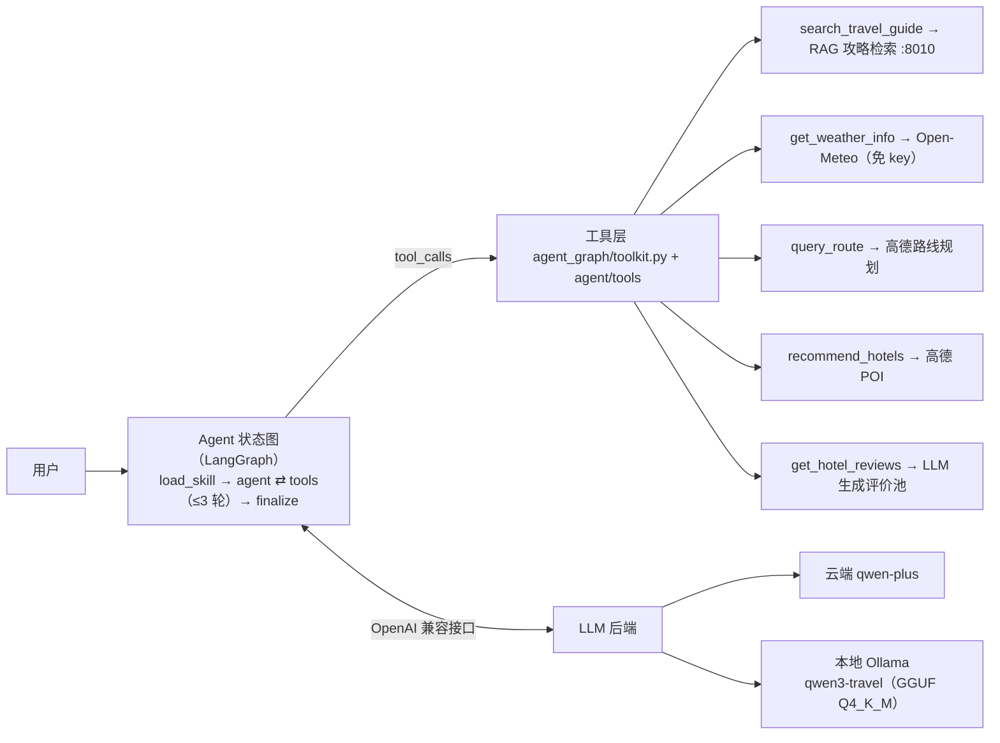
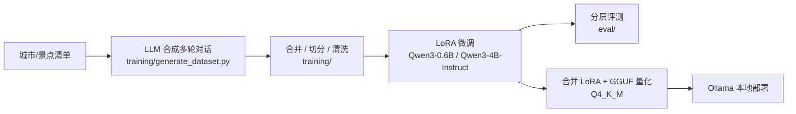

# Travel Assistant · Agent + SFT 全链路

> 垂直领域旅行助手：**合成训练数据 → LoRA 微调小模型 → 分层评测 → 量化部署 → 工具调用 Agent 集成**，全链路自研且可复现。

技术栈：Python · Qwen3（0.6B / 4B）· LoRA (PEFT) · OpenAI 兼容 API · GGUF / Ollama · Milvus · Flask · LangGraph

---

## 效果一览

工具调用评测（112 个真实场景，测试集见 `datasets/merged_test_final.json`）：

| 模型 | 合法 tool_call | 工具名匹配 | 参数键匹配 | 参数值一致 |
|---|---|---|---|---|
| Qwen3-0.6B 基座（未微调） | 0/112 (0.0%) | 0.0% | 0.0% | 0.0% |
| Qwen3-0.6B + LoRA | 90.2% | 83.9% | 79.5% | 67.9% |
| Qwen3-4B-Instruct + LoRA | **92.9%** | **92.9%** | **87.5%** | **76.8%** |

- 终答场景（30 条）：两个微调模型的"最终答复中无工具调用泄漏"比例均为 90%。
- 未微调的 0.6B 完全不会产出结构化工具调用（只会用自然语言反问用户）；微调把它从 **0 → 90.2%**。
- 说明：0.6B 与 4B 的评测数字均为当时的运行记录，测试集与评测脚本随仓库提供。
  **0.6B 的基座与微调产物已删除**（训练实例释放 + 本地清理），故 0.6B 两行不可本地复现；
  **4B 全链路产物在本机保留**（LoRA adapter + 量化 GGUF + Ollama 模型），可重建。
  本地可复现的评测入口是 `eval/eval_ollama_accuracy.py`（评测 Ollama 中的部署形态）。
- 口径提醒：4B 行为 Ollama（**Q4_K_M 量化**）形态、0.6B 行为 transformers（**未量化**）形态，
  两者精度口径不同，不宜直接横向比较。
- 口径提醒：以上数字是**改动前**的记录。`all_tools.json` 的 `num_days` 描述于 2026-09-29 修正
  （原描述指向攻略文档里的随机天数），同子集 A/B 差异约 1/30 条；
  冻结的旧 schema 可用 `git show <旧提交>:datasets/all_tools.json` 复现并重跑对照。

## 项目做什么

一个"会按规矩调工具"的旅行助手 Agent：

- **行程规划**：先检索攻略（RAG）再看天气（Open-Meteo），综合生成逐日行程
- **问路导航**：地名/坐标 → 高德路线（步行 / 公交 / 驾车对比）；公交方案支持跨城出行，铁路段（高铁/普速）按车次渲染（如 `G370 郑州东 上车 → 北京西 下车（约138分钟）`）
- **酒店推荐与评价**：高德真实 POI + LLM 生成的评价池（模拟数据，界面明确标注）
- **信息不足时主动反问**：缺城市 / 缺日期 / 缺起点时一次只问一个问题
- **非旅行问题礼貌拒答**

Agent 用 **LangGraph 状态图**编排 function calling 循环（`load_skill → agent ⇄ tools → finalize`），模型自主决定调哪个工具、调几轮、何时收口；代码层提供轮次预算与收尾护栏（见"设计取舍"）。

## 架构

**运行时**：



**数据与训练链路**：



## 核心特性

- **工具调用可靠性治理**：四层防护（轮次预算、收尾轮强制文本、尾部提示、输出清洗兜底），解决小模型把工具调用当文本泄漏给用户的问题
- **转述保真护栏**：抽取答复里的线路名、"数字+单位（分钟/元/米）"与**站名**（站名是开放词表无法枚举，因此反向以工具结果为唯一事实来源，锚在"上车/下车/到X站"这类结构化措辞上），逐项核对是否出现在工具结果里；对不上则**降级为面向用户的原始结果**（去掉 `(策略: …)` 这类面向模型的注记 + 说明"未经汇总整理"），并把命中率记进日志。小模型在长结构化文本上会改写站名、线路号、数字（实测 `313元→"314元"`、`地铁8号线→"地铁1号线八通线"`、凭空多出一个"天安门东站"），而"是否一致"可以被代码判断——所以由代码兜底，而不是指望模型自觉。**已知边界**：只查"事实是否存在"，不查"归属与顺序"（方案1写成方案2的票价、上下车写反仍会漏放）
- **公交偏好的三级仲裁（规则 → 本地 4B → 默认值）**：`strategy` 参数**不进 tool schema**，由代码在工具调用落地处注入——因为微调模型没在训练数据里见过它，而评测的参数匹配是**键集合完全相等**，模型多吐一个键会让 keys/vals 两档同时失配。规则层覆盖可枚举的意图（少换乘/少走路/不坐地铁/最便宜/最快），规则未命中时用一次本地 4B 兜底长尾表达（实测 3.8s，带缓存 2ms），都没有则按最快捷
- **分层评测体系**：合法 JSON → 工具名 → 参数键 → 参数值，四层定位"差在哪一步"；支持基座 / 基座+LoRA / 部署形态（Ollama）三种评测对象
- **数据合成管线**：按意图模板合成多轮对话（规划/问路/酒店/闲聊/拒答），含进度记录与断点续跑
- **数据清洗规则**：`training/sanitize_dataset.py` 剔除污染样本、敏感明文占位符化，可对重新生成的数据复跑
- **双后端部署**：云端 qwen-plus（快）与本地量化 4B（离线、CPU 可跑），环境变量一键切换
- **轻量可观测性**：每轮对话输出工具轮次、LLM/工具耗时与 token 用量统计；另有**请求流水日志**（`agent/tools/request_log.py`，一条事件一行 JSONL 落 `logs/`，用 `trace_id` 串联同一次请求的 LLM/高德/护栏事件），`python scripts/request_log_report.py` 一键出报告——LLM 与高德各接口的成功率、延迟 P50/P95、tokens、工具调用分布、护栏触发率、失败明细（含高德 `status != 1` 这类以前静默的业务失败）。日志只记白名单字段并对 `key=` 兜底脱敏，不落消息内容
- **合规标注**：酒店评价明确标注"模拟生成"；攻略信息与高德数据分源标注（"旅友推荐" vs "数据来源：高德"）

## LangGraph Agent 实现

`agent_graph/` 是项目的 Agent 运行时：

- **图结构**：`load_skill` → `agent` ⇄ `tools` 循环（轮次预算 3）→ `wrap_up` 收尾轮 → `finalize` 出口护栏；
- **工具层自包含**：`agent_graph/toolkit.py` 提供 5 个工具、保真护栏与策略检测；模型侧 tool schema 与 `datasets/all_tools.json` 完全一致；公交偏好由代码在 `query_route` 调用前注入（不进 schema）；
- **状态持久化**：`SqliteSaver`（`agent_memory.sqlite`），按 `thread_id` 恢复；网页 Demo 启动时列出历史会话供选择续接；
- **流式输出**：网页 Demo 用 `graph.stream(stream_mode="messages")` 逐 token 渲染；流结束后以图状态的 `final_answer` 校正（护栏降级时替换为原始结果），兼顾体验与保真；
- **跨城问路**：云端规则引导主动调用 `query_route` 获取铁路方案（G/K 字头车次）；图版在工具执行前用用户原话中的「从 X 到 Y」纠正模型幻觉坐标；工具同时支持地名与坐标终点；
- **可观测性**：LangChain 回调把 LLM 耗时 / tokens / 工具名写入原有请求流水（`logs/`），报告脚本口径不变；LangSmith 暂未接入（预留环境变量即可开启）。
- **测试**：122 个单元测试全绿。

```bash
pip install langgraph langchain-openai langgraph-checkpoint-sqlite
python -m agent_graph.smoke_chat          # 两轮闲聊 + SQLite 记忆
python -m agent_graph.smoke_agent         # 工具链冒烟（可传问题/线程）
python -m agent_graph.web_demo_graph      # 网页 Demo（含历史会话选择）
```

### Skill 渐进式披露（Claude Agent Skills 格式）

- `skills/itinerary-review/SKILL.md`：frontmatter（name/description）+ 五步审查流程（结构 → 地理 → 天气 → 攻略 → 报告），路由条件写在 description 中；
- `load_skill` 节点按「审查意图 + 行程上下文」规则路由，命中才加载技能正文；
- 技能级工具子集：审查技能只绑定 `search_travel_guide` / `get_weather_info` / `query_route`（5 → 3）；
- 渐进式披露收益（cl100k_base 估算）：default 完整 prompt **3114 tokens** → 审查技能模式 **1193 tokens**（正文 858 + 清单 42），降幅 **61.7%**；
- **微调模型保护**：default 技能 = 原 system prompt 字节级，本地后端（4B）恒走 default 且不启用技能路由；只有云端启用技能路由。同一审查问题下云端命中技能、本地 4B 保持 default，均已实测。

> 护栏策略（2026-10-17 优化）：① 核对前先剥离 markdown 强调符，加粗站名（如 `**天桥站**`）不再误报；② **按工具类型启用**——路线/酒店类结构化结果做完整保真核对，攻略+天气类场景跳过核对（攻略是参考资料，允许提炼与常识性补充），规划场景不再频繁降级；③ 结构化场景中模型确实改写数字时仍降级为原始结果，降级率可作为转述保真度的实时指标。

## 评测

评测脚本（`eval/`）与测试集（`datasets/`）随仓库提供：

```bash
# 分层评测：基座 + LoRA（支持 CPU / GPU，自动识别）
python eval/eval_toolcall_accuracy.py --base_model ./qwen3-0_6b \
    --adapter_path ./qwen3-0_6b_lora_last_assistant --mode both

# 只评基座（--adapter_path 留空或 none）
python eval/eval_toolcall_accuracy.py --base_model ./qwen3-0_6b --mode toolcall

# 评测部署形态（Ollama 中的 GGUF 模型）
python eval/eval_ollama_accuracy.py --model qwen3-travel --limit 50
```

数据路径默认自动定位 `datasets/`，在任意目录运行均可。

## 快速上手

```bash
# 1. 环境
python -m venv .venv
.venv\Scripts\activate            # Windows；Linux/macOS: source .venv/bin/activate

# 只跑 Agent（不训练）装轻量依赖即可：
pip install requests openai python-dotenv
# 需要 RAG 攻略检索时再加：pip install flask pymilvus jieba
# 完整依赖（含训练）：pip install -r requirements.txt

# 2. 配置密钥（.env 不会提交，模板见 .env.example）
copy .env.example .env            # 填入 AMAP_KEY（高德开放平台免费申请）
```

**云端模式**（qwen-plus，响应快）：

```bash
# 先设置环境变量 DASHSCOPE_API_KEY
scripts\start_agent_cloud.bat
```

**本地模式**（本地量化模型，离线、CPU 可跑）：

```bash
# 需要已安装 Ollama，并准备好 GGUF 模型（见"复现训练"第 4 步）
ollama create qwen3-travel -f Modelfile
scripts\start_agent_local.bat
```

**网页 Demo（Gradio）**：`scripts\start_web_demo.bat`（或 `python -m agent_graph.web_demo_graph`），浏览器打开 http://127.0.0.1:7860 即可对话；会话状态持久化在 SQLite，可续接历史会话。

**RAG 攻略服务（可选）**：`scripts\start_rag.bat`。需要 Milvus 与 DashScope 嵌入模型的 key；未启动时"攻略检索"工具会提示服务不可用，其余功能不受影响。

> 非 Windows 环境：`scripts/*.bat` 仅为 Windows 便捷启动器；其他系统直接运行 `python -m agent_graph.web_demo_graph`，本地模式只需把 LLM 环境变量指向你的 Ollama 地址（见 `.env.example`）。

**示例会话**（本地模式实跑输出，节选）：

```text
您: 推荐北京的商务酒店，并看看评价
🔧 调用工具: recommend_hotels   → 数据来源：高德（真实 POI）
🔧 调用工具: get_hotel_reviews  → 评价池（模拟生成，仅供参考）
助手: 根据您的需求，推荐以下商务酒店（数据来源：高德）……
```

## 复现训练

1. **合成场景**：`training/generate_dataset.py` —— **模板 + 随机组合，不需要 LLM**（规划 60 / 问路 30 / 酒店 23 条问题模板 × 城市·地标·预算·日期等填充 + 88 条预置追问）→ `travel_assistant_dataset_<时间戳>.json`（**1010 条**，8 个业务字段）
2. **分层切分**：`training/split_dataset.py` —— 按 `工作流 × 是否追问` 分 8 组，各组 80/20（`seed=42`）→ 训练 808 / 测试 202
3. **执行轨迹蒸馏（开发期脚本，未随仓库提供）**：用云端模型 + 真实工具跑出多轮 tool_call / 工具结果轨迹，再转换为训练格式。训练数据本身同样不随仓库提供（体积与来源原因）。
4. **合并 → 拆分 → 清洗**：`merge_json_files.py`（合并 batch）→ `conversation_splitter.py`（按 assistant 逐条前缀切分，**末轮终答复制 3 份**）→ `sanitize_dataset.py`（本份数据零命中，输出与输入一致）
5. **LoRA 训练**（GPU 环境，脚本为 AutoDL 实测命令）：`scripts/run_train_0_6b.sh` / `scripts/run_train_4b_2507.sh`（`--tools_file datasets/all_tools.json` 注入工具 schema；损失掩码 `only_last_assistant`）
6. **合并与量化**：`training/merge_lora_into_base.py` → GGUF（Q4_K_M）→ `ollama create` 部署

> 训练数据不随仓库提供（体积与来源原因）：生成脚本、测试集与工具 schema 齐备，可按上述流程重建。

## 目录结构

```text
Agent+SFT/
├─ agent_graph/    # LangGraph Agent：状态图、节点/路由、工具层、技能、SQLite 持久化、Web Demo
├─ agent/          # 底层工具与数据层：高德/天气/酒店/RAG 客户端、城市与策略工具
├─ skills/         # Claude Agent Skills 技能包（itinerary-review）
├─ training/       # 数据合成/训练/清洗脚本
├─ eval/           # 分层评测（transformers / Ollama 两个版本）
├─ tests/          # 单元测试（pytest）
├─ scripts/        # 一键启动 .bat 与训练命令 .sh
├─ datasets/       # 测试集、工具 schema、数据产物（训练集不随仓库提供）
├─ data/           # RAG 攻略语料的生成脚本
├─ rag-system/     # 可选：RAG 服务（Flask + Milvus）
└─ logs/           # 运行日志
```

## 设计取舍

- **用 LangGraph 手搭状态图，不用高层封装**：控制流显式（agent ⇄ tools 循环、收尾轮、出口护栏都是节点与条件边），每一轮的输入输出可打印、可断言，评测才能精确落到"哪一层错了"；同时获得状态持久化与流式输出能力。
- **软约束 + 硬护栏组合**：工具调用顺序等规则写在 prompt（软约束，灵活）；轮次预算、收尾轮、结果清洗在代码层（硬护栏，保底）。代价是硬护栏存在刚性（如工具链判断只覆盖部分场景），收益是端到端行为可控。
- **评测分层而非单一准确率**：工具调用是"格式 + 选择 + 参数"的复合技能，单一数字无法定位问题；分层指标直接指向优化方向（如"参数值一致性"通常是最难的一层）。
- **信息优先级显式声明（用户消息 > 用户信息）**：一次模型更新曾让 Agent 把"用户信息未提供城市"误读为"用户没说城市"而反复反问——prompt 加固后明确优先级并保留回归用例。
- **模型规模选择**：0.6B 基座完全不具备工具调用格式能力（0%），LoRA 后达 90.2%；4B 各项更高且量化后本机 CPU 可跑，因此部署选 4B Q4_K_M。
- **数据合规**：酒店评价为 LLM 模拟生成并显式标注，不冒充真实评论；攻略提及的酒店以"旅友推荐"呈现，与可查证的 POI 数据分源。

## 已知限制

- RAG 攻略检索需要外部 Milvus 服务；未启动时该工具降级（其余功能正常）
- 高德地理编码对裸 POI 名可能跨城匹配（如"颐和园"）；已部分落地（补城市前缀 + "名字点名的城市优先"判据），根治仍需改用 POI 搜索接口
- **覆盖率类指标是结构性保证，不等于检索准确率**：RAG 的"731/731 Top1/Top3 全绿"里，同一份城市映射表既生成候选集、又定义语料清单，且结果按城市聚合（该城任意一块过阈值即命中）——真正缺的是**块级/多城市排序**用例
- RAG 语料覆盖 731 城（34 省，含 387 县级市）；**景点级与语料外地点走联网兜底，而兜底只对名单内地点生效**，名单外的会退化成全库检索；3 个已撤销的行政区划老名字（惠阳市/海丰市/米泉市）未收录
- **工具返回文本的格式与训练数据不一致**：训练/测试集里的工具消息是旧格式（单条方案、无标签），改为多方案带标签后，模型运行时看到的工具文本偏离了训练分布。由于评测脚本的上下文取自测试集自带的工具消息，**该差异不在自动评测的覆盖范围内**，只由端到端用例验证——"指标全覆盖"不等于"交付全覆盖"
- **`all_tools.json` 是运行时与训练脚本的共用契约**：若按其重训模型，需同步复跑 `eval/` 回归——测试集的参考调用不含新增键，模型一旦"学会"多传参数就会在 keys / vals 两档失配
- 0.6B 微调产物未保留，该行数字不可复现（测试集与评测脚本可复现评测流程本身）
- 本地模式为 CPU 推理，单轮响应较慢（1–3 分钟）；GPU 环境可显著加速
- **量化掉点未做完整对照**：4B 的评测数字是在 **Q4_K_M** 形态下测的。用 0.6B 做过机制验证（Q4 vs Q8，短文本复制任务上**无差异、编造数字为 0**）→ 可判断量化不是数字失真的主因；但 **4B 自身的 bf16 vs Q4 仍未对照**（本地无 GPU，bf16 推理不可行）

